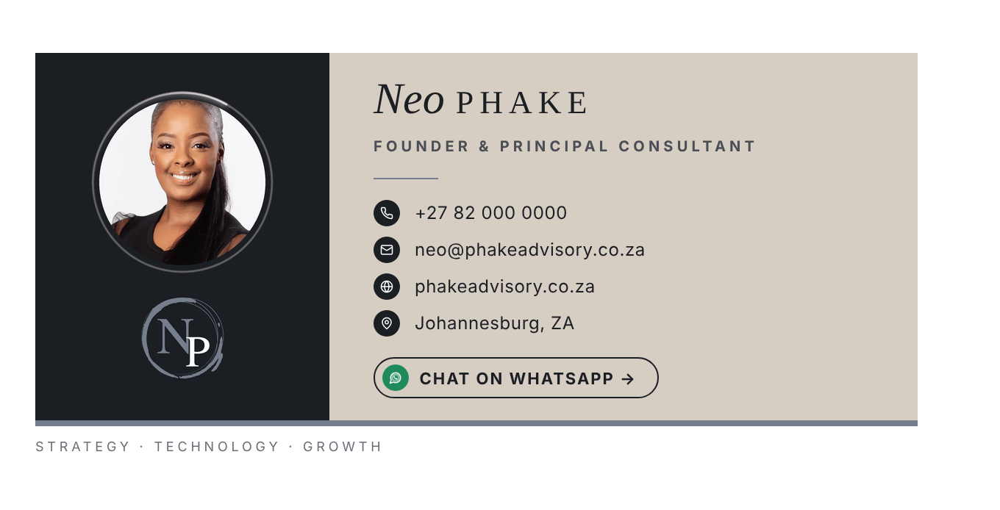
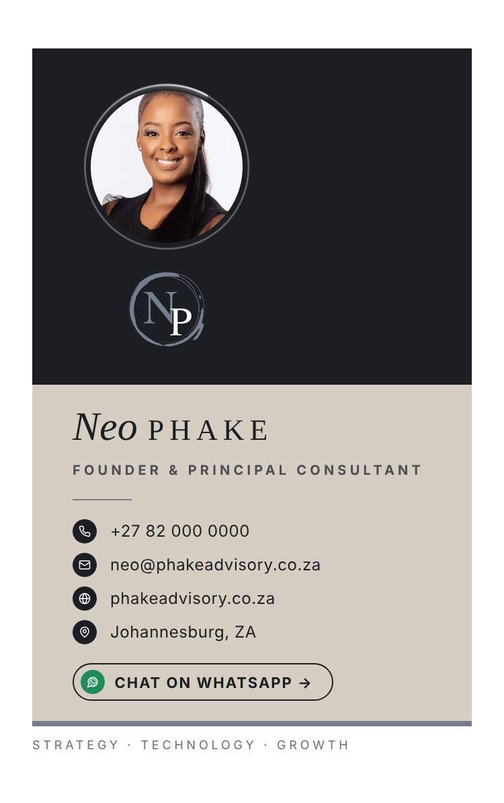
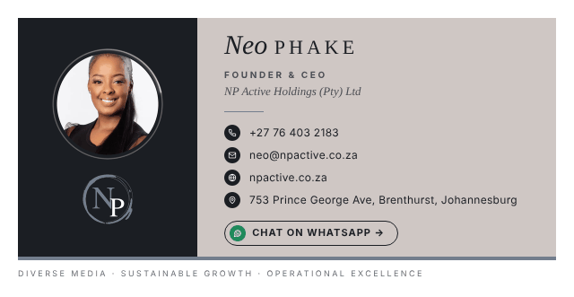

# Neo Phake: Email Signature

A two-panel, table-based HTML email signature for Neo Phake, styled after the supplied reference sheet and built around the NP monogram. A charcoal panel holds the portrait and logo, and a warm taupe panel holds the name, title, contact rows and WhatsApp call to action. It is built for Gmail, Outlook and Apple Mail.

| Desktop | Phone (stacks automatically) |
|---|---|
|  |  |

Motion (recorded from the live signature):



Simulated dark mode (forced colour inversion, as in Outlook and the Gmail apps):


## Files

| File | Purpose |
|---|---|
| `signature.html` | **Copy-ready animated signature** built from `config.json` (sample contact values until you replace them) |
| `signature-static.html` | Same signature with still images only |
| `signature.template.html` | Same signature with every variable as a `{{PLACEHOLDER}}` |
| `config.json` | Neo's details. Edit this file, then rebuild |
| `build.py` | Fills the template, checks number formats, and writes both signatures plus their `preview/` copies |
| `scripts/make_animations.py` | Renders the four animated GIFs from `assets/src/` |
| `assets/src/` | Original portrait and logo files used to render the images |
| `assets/neo-phake-portrait.png` | 248×248 round portrait with a taupe ring (shown at 124×124 for retina sharpness) |
| `assets/np-logo.png` | NP monogram lifted onto a transparent background, for the charcoal panel |
| `assets/np-logo-light.png` | Monogram variant with a charcoal "P", for light backgrounds (not used in the signature) |
| `assets/icon-*.png` | Round contact icons (phone, email, web, location, WhatsApp), 72px for 18px display |
| `assets/*-live.gif` | Animated portrait ring, monogram, rule and WhatsApp icon |
| `assets/rule.png` | Still version of the slate rule |
| `preview/` | Local preview HTML and rendered screenshots |

## Design notes

- **Style:** two-tone panels taken from the reference sheet. Charcoal `#1B1E23` and taupe `#D6CDC3`, with the monogram's slate `#757E8C` used for the short rule and the baseline.
- **Typography:** the name echoes the serif monogram. *Neo* is set in Georgia italic and PHAKE in spaced Georgia capitals. The title uses small, tracked sans-serif capitals. Contact details use Helvetica/Arial at 12px.
- **Logo:** the monogram was extracted from its textured background, so it sits cleanly on the charcoal panel at 52px.
- **WhatsApp:** an outlined charcoal pill with a green WhatsApp icon reads `CHAT ON WHATSAPP →`. It is drawn with a cell border, so Outlook keeps it.
- **Background colours stripped:** all text sits on the taupe panel in charcoal, so it stays readable on plain white. Only the photo and logo sit on charcoal.
- **Phones:** the two panels are `align="left"` tables. They sit side by side at 600px and stack on a phone, with the charcoal band filling the full width.
- **Dark mode:** clients that invert colours flip the panels (charcoal turns light and taupe turns dark). Text stays readable, as the dark-mode preview shows.

## Motion

Email clients don't run CSS animation or JavaScript, so the motion comes from four small animated GIFs. All the text stays live.

| Element | Motion | Loop | Size |
|---|---|---|---|
| Portrait ring | A soft light arc orbits the ring | 3.3 s | 159 KB |
| NP monogram | A diagonal light sheen passes over the strokes | about 6 s | 39 KB |
| Rule under the title | A glint travels along the slate line | about 3.4 s | 15 KB |
| WhatsApp icon | A ripple spreads out from the glyph | about 3.4 s | 39 KB |

- **Where it plays:** Gmail (web and apps), Apple Mail, iPhone Mail, Outlook on the web, Outlook for Mac and the new Outlook for Windows.
- **Classic Outlook for Windows:** shows only the first frame. Every GIF's first frame is the finished still, so nothing looks broken.
- **Pace:** the motion is slow, with pauses between passes, so it doesn't distract while someone reads the email.
- **Turning it off:** use `signature-static.html` for an identical signature with no motion.
- **Changing the motion:** edit `scripts/make_animations.py`, then run `python3 scripts/make_animations.py && python3 build.py`.

## Placeholders

| Placeholder | Current value | Notes |
|---|---|---|
| `{{FIRST_NAME}}` / `{{LAST_NAME}}` / `{{FULL_NAME}}` | Neo / Phake / Neo Phake | |
| `{{JOB_TITLE}}` | Founder & Principal Consultant | **SAMPLE: confirm** |
| `{{PHONE_DISPLAY}}` | +27 82 000 0000 | **SAMPLE**: how the number is shown |
| `{{PHONE_E164}}` | +27820000000 | **SAMPLE**: used in `tel:`; `+27`, no spaces, no leading 0 |
| `{{WHATSAPP_NUMBER}}` | 27820000000 | **SAMPLE**: used in `https://wa.me/…`; no `+`, spaces or leading 0 |
| `{{EMAIL}}` | neo@phakeadvisory.co.za | **SAMPLE** |
| `{{WEBSITE_URL}}` / `{{WEBSITE_DISPLAY}}` | https://www.phakeadvisory.co.za / phakeadvisory.co.za | **SAMPLE** |
| `{{LOCATION}}` | Johannesburg, ZA | **SAMPLE**: shown with the pin icon |
| `{{TAGLINE}}` | Strategy · Technology · Growth | **SAMPLE**: or delete the last row of the template |
| `{{ASSET_BASE}}` | GitHub raw URL of the `assets/` folder | Public **https** folder holding the portrait, logo and icons (see below) |

**Converting a South African number:** `082 123 4567` becomes `+27821234567` for the phone field and `27821234567` for WhatsApp.

### Still needed from Neo
1. Exact job title.
2. Mobile number, which is also used for WhatsApp unless a separate business number is preferred.
3. Email address and website.
4. Where to host the images. The default GitHub raw URL only works while this repository is **public**. Copying the `assets/` folder to the company website or a CDN and pointing `ASSET_BASE` at it is more permanent.

## Rebuild after editing

```bash
python3 build.py
```

The script warns you if the WhatsApp or phone number is not in South African international format.

## Installing

Always copy the **rendered** signature, not the source code. Open `signature.html` in Chrome, Safari or Edge, press **Ctrl/Cmd + A**, then **Ctrl/Cmd + C**.

### Gmail (web)
1. Open the gear icon, then **See all settings → General → Signature → Create new**. Name it "Neo Phake".
2. Click in the editor and paste with **Ctrl/Cmd + V**.
3. Under **Signature defaults**, choose it for new emails and for replies and forwards.
4. Optional: tick *Insert signature before quoted text*.
5. Click **Save Changes** at the bottom of the page.
6. If the images don't appear, `ASSET_BASE` is not publicly reachable. Host it elsewhere, rebuild, and paste again.

The Gmail mobile apps use the web signature only when the mobile signature setting is turned off.

### Outlook (new Outlook for Windows / Outlook on the web)
1. Go to **Settings → Accounts → Signatures → + New signature** and name it.
2. Paste into the editor.
3. Set it as the default for new messages and for replies and forwards, then click **Save**.

### Outlook (classic desktop for Windows)
1. Go to **File → Options → Mail → Signatures… → New**.
2. Paste into the edit box. Outlook keeps the table layout and borders.
3. Choose defaults for new messages and replies, then click **OK**.
4. Alternative: save `signature.html` as `%APPDATA%\Microsoft\Signatures\Neo Phake.htm`.

### Outlook for Mac
Go to **Outlook → Settings → Signatures → +**, paste, then set the defaults.

### Apple Mail (macOS)
1. Go to **Mail → Settings → Signatures**, select the account, and click **+**.
2. **Untick "Always match my default message font"**. If this stays ticked, the typography is overwritten.
3. Paste the copied signature into the right-hand pane and select it as the account's default.
4. If the image breaks, quit Mail, open `~/Library/Mail/V10/MailData/Signatures/` (V9 or V11 on other versions), edit the newest `.mailsignature` file, replace the body after the header lines with the contents of `signature.html`, save it, and lock the file (**Get Info → Locked**).

### iPhone Mail
iOS only stores plain or lightly styled signatures. Email the signature to yourself from desktop, copy it from the received message, and paste it into **Settings → Apps → Mail → Signature**. Shake to undo if iOS strips the formatting.

## Testing checklist

Send a test email to a Gmail address and an Outlook address, then check each item on both a desktop and a phone.

- [ ] **WhatsApp:** tap *Chat on WhatsApp →*. WhatsApp (or WhatsApp Web) opens a chat with **Neo's number** (not 27820000000).
- [ ] **WhatsApp URL:** hover over the link. It reads exactly `https://wa.me/27XXXXXXXXX`, with no `+`, spaces or leading 0.
- [ ] **Phone:** on a phone, tapping the number offers to call `+27…`. On desktop it offers FaceTime, Teams or Skype.
- [ ] **Email:** clicking the address opens a new message addressed to Neo.
- [ ] **Website:** the link opens the correct site over **https**, and so does the portrait, which also links to the site.
- [ ] **Motion:** the ring, monogram, rule and WhatsApp icon animate in Gmail or Apple Mail. In classic Outlook they show as clean stills.
- [ ] **Images:** the portrait, logo and icons load for an external recipient with images enabled. With images blocked, the alt text shows instead ("Neo Phake", "NP", "Mobile" and so on).
- [ ] **Dark mode:** the name and contact details stay readable in Gmail (iOS/Android), Outlook and Apple Mail in dark mode.
- [ ] **Layout:** the signature sits side by side on desktop and stacks neatly on a phone, with no horizontal scrolling.
- [ ] **Replies:** the signature appears on replies and forwards, if enabled.
